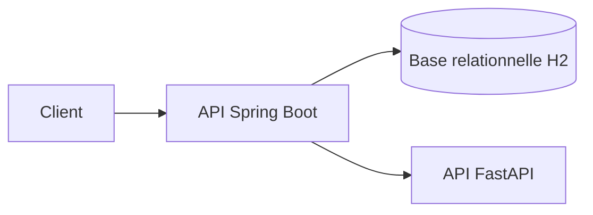
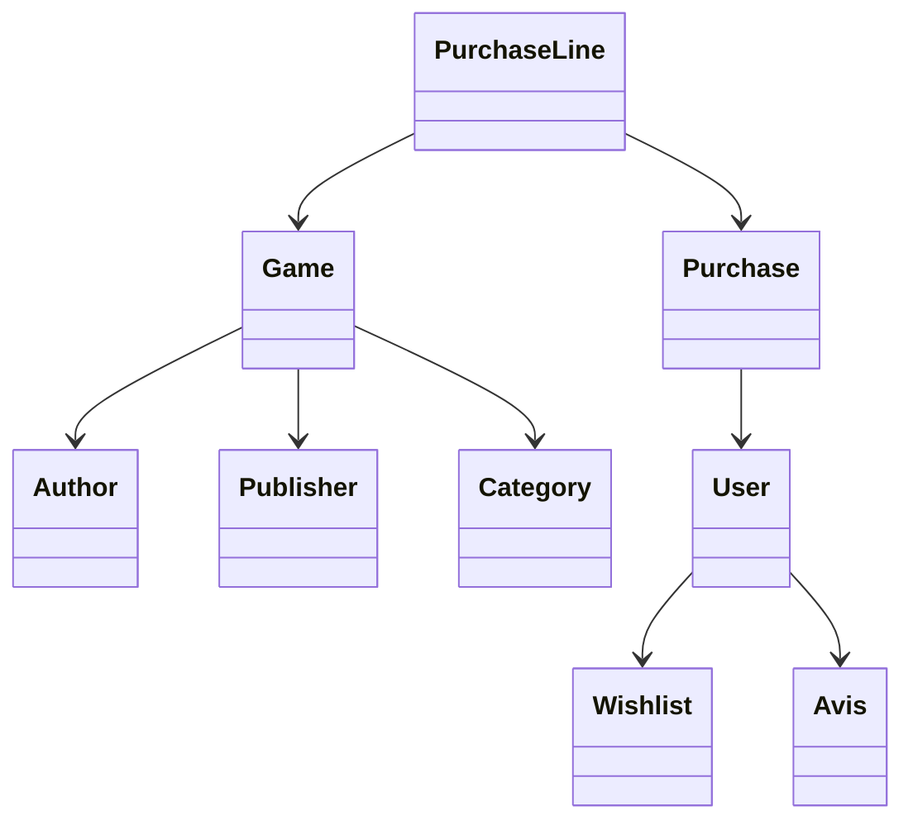
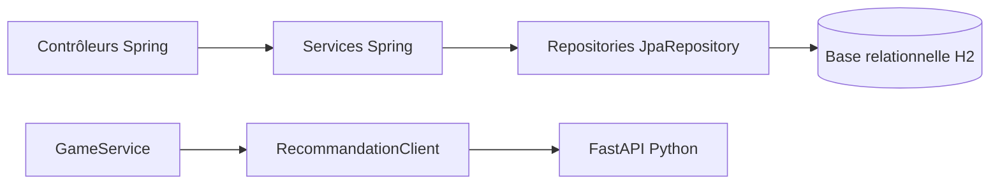
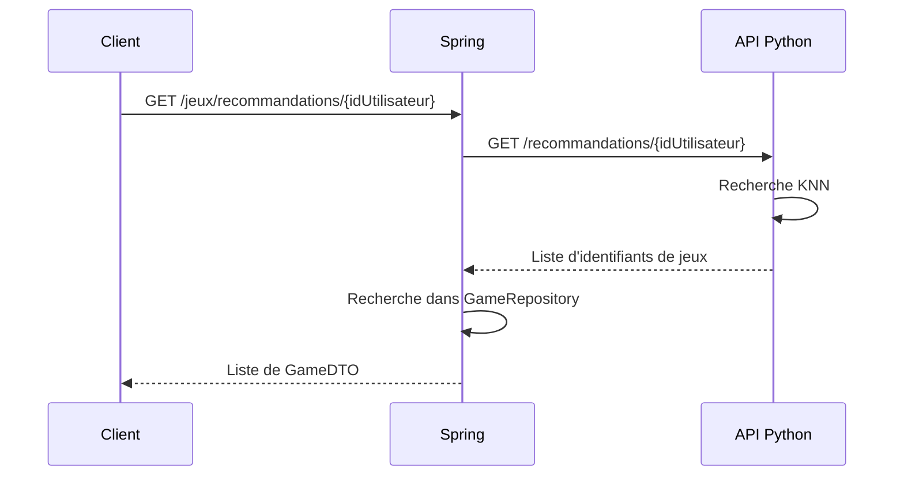

# Documentation de gamesUP

## 1. Architecture



Le projet utilise Spring Boot 3.3.4 et Java 21. Les contrôleurs appellent les services. Les services utilisent les repositories JPA. Spring appelle l'API Python avec `RecommandationClient`.

La sécurité prévoit un utilisateur `client` avec le rôle `CLIENT` et un utilisateur `admin` avec le rôle `ADMIN`. Les deux peuvent consulter les jeux.
Les modifications sont réservées à l'administrateur, selon
`gamesUP/src/main/java/com/gamesUP/gamesUP/config/SecurityConfig.java:35`.

## 2. Diagramme de classes



Les classes principales sont `Game`, `Author`, `Publisher`, `Category`, `User`, `Purchase`, `PurchaseLine`, `Wishlist` et `Avis`. Elles sont des entités JPA, par exemple dans `gamesUP/src/main/java/com/gamesUP/gamesUP/model/Game.java:9`.

## 3. Composants



La dépendance JPA est déclarée dans
`gamesUP/pom.xml:42`. Les repositories étendent `JpaRepository`, par exemple `gamesUP/src/main/java/com/gamesUP/gamesUP/repository/GameRepository.java:9`.
La base H2 est déclarée en portée runtime dans `gamesUP/pom.xml:54`.

## 4. Séquence d'une recommandation



La recherche de jeux est disponible avec
`GET /jeux/recherche?nom=...`, dans
`gamesUP/src/main/java/com/gamesUP/gamesUP/controller/GameController.java:27`.

La route Spring est dans
`gamesUP/src/main/java/com/gamesUP/gamesUP/controller/GameController.java:32`.
Le service appelle `RecommandationClient` dans
`gamesUP/src/main/java/com/gamesUP/gamesUP/service/GameService.java:64`.
La route Python est dans `CodeApiPython/main.py:38`.

## 5. Principes SOLID

- **SRP (responsabilité unique)** : exemple réel dans `gamesUP/src/main/java/com/gamesUP/gamesUP/controller/GameController.java:16-20`. Le contrôleur reçoit `GameService` et lui délègue la logique.
- **OCP (ouvert à l'extension)** : non appliqué de façon significative dans ce projet. Aucun exemple clair d'extension sans modification n'a été vérifié.
- **LSP (substitution)** : non appliqué de façon significative dans ce projet. Aucune hiérarchie de classes utilisée pour cet objectif n'a été vérifiée.
- **ISP (séparation des interfaces)** : non appliqué de façon significative dans ce projet. Le projet utilise surtout les interfaces fournies par Spring Data.
- **DIP (inversion des dépendances)** : exemple réel dans `gamesUP/src/main/java/com/gamesUP/gamesUP/service/GameService.java:17`. Le service reçoit ses dépendances par constructeur.

## 6. Couverture des tests

La commande `.\mvnw.cmd clean test jacoco:report` a donné :

- 76 tests exécutés ;
- 0 échec ;
- 0 erreur ;
- 2 tests ignorés ;
- `BUILD SUCCESS`.

Depuis `gamesUP/target/site/jacoco/jacoco.csv` :

- instructions : `1053 / 1338`, soit **78,70 %** ;
- branches : `5 / 6`, soit **83,33 %**.

La couverture est identique à la référence demandée : **78,70 % / 83,33 %**.

## 7. Système de recommandation

Les données nécessaires sont `user_id`, `game_id` et `interaction`. Le fichier `CodeApiPython/donnees_test.csv` contient des données **fictives** utilisées pour vérifier le script.

`CodeApiPython/train_model.py:9` construit une matrice utilisateur-jeu, entraîne `NearestNeighbors` avec la distance cosine et sauvegarde le modèle
dans un fichier pickle.

`CodeApiPython/main.py:12` charge `CodeApiPython/knn_model.pkl`. Si le fichier manque, les routes de recommandation renvoient HTTP 503 avec le message « Le modèle de recommandation est indisponible. », dans
`CodeApiPython/main.py:20`.

Le fichier `knn_model.pkl` n'est pas versionné. Il est régénéré avec `train_model.py` à partir de données fictives.

Les fichiers concernés sont :

- `CodeApiPython/main.py` ;
- `CodeApiPython/recommendation.py` ;
- `CodeApiPython/train_model.py` ;
- `gamesUP/src/main/java/com/gamesUP/gamesUP/service/RecommandationClient.java`.

Limites constatées :

- les données de `donnees_test.csv` sont fictives ;
- le modèle a été produit avec ces données fictives ;

## 8. Lancer l'API Python

Depuis `CodeApiPython/` :

```powershell
py .\train_model.py .\donnees_test.csv .\knn_model.pkl
py -m uvicorn main:app --port 8000
```

Commandes HTTP testées :

```powershell
curl.exe -i http://localhost:8000/
curl.exe -i http://localhost:8000/recommandations/1
curl.exe -i -X POST http://localhost:8000/interactions -H "Content-Type: application/json" --data-binary "@interaction.json"
```

Résultats vérifiés :

- `/` : HTTP 200 ;
- `/recommandations/1` : HTTP 200, réponse `[3,5,4]` ;
- `/interactions` : HTTP 200 ;
- sans `knn_model.pkl`, `/recommandations/1` : HTTP 503 avec un message en français.

## 9. Tester le projet

### Lancer les API

Depuis la racine du projet :

```powershell
cd CodeApiPython
py -m uvicorn main:app --port 8000
```

Dans un autre terminal :

```powershell
cd gamesUP
.\mvnw.cmd spring-boot:run
```

### Lancer les tests

Depuis `gamesUP/` :

```powershell
.\mvnw.cmd clean test jacoco:report
```

Depuis `CodeApiPython/` :

```powershell
py -m pytest test_main.py -v
```

Si `pytest` n'est pas installé :

```powershell
py -m pip install pytest httpx
```

### Exemples de requêtes

Le serveur Spring utilise le port `8080`, défini dans
`gamesUP/src/main/resources/application.properties:2`. Le serveur Python
utilise le port `8000`.

```powershell
curl.exe -i http://localhost:8080/jeux
curl.exe -i "http://localhost:8080/jeux/recherche?nom=Azul"
curl.exe -i http://localhost:8080/jeux/recommandations/1
curl.exe -i http://localhost:8000/
curl.exe -i http://localhost:8000/recommandations/1
```

Sans `knn_model.pkl`, l'API Python répond HTTP 503. Pour recréer le modèle :

```powershell
cd CodeApiPython
py .\train_model.py .\donnees_test.csv .\knn_model.pkl
```

## 10. Réflexion

### Bonnes pratiques observées

1. Les contrôleurs délèguent la logique aux services.
2. Les tests de contrôleurs utilisent MockMvc, par exemple
   `gamesUP/src/test/java/com/gamesUP/gamesUP/controller/GameControllerTest.java:32`.
3. Les dépendances des services sont reçues par constructeur.

### Mauvaises pratiques rencontrées

1. Le fichier `.metals/metals.log` était suivi par Git ; il a été retiré du
   suivi et ajouté à `.gitignore`.
2. Le modèle KNN était d'abord entraîné en mémoire au démarrage au lieu d'être chargé depuis un fichier.
3. Les données de test KNN sont fictives et ne remplacent pas encore des
   données réelles.
